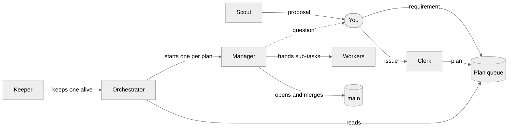
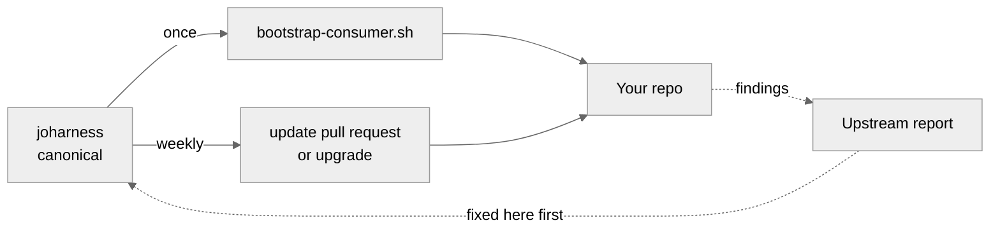

# joharness

A harness that lets Claude Code sessions work on a repo for days without a
person watching. You describe what you want; sessions turn it into plans,
build each plan on its own branch, check it, and merge it. Git is the only
memory they share, so any session can stop and the next one picks up where
the last one left off.

This repo is the canonical copy. Other repos install it once and sync from
it weekly.

## The short version

You write down what you want. A small cast of Claude sessions does the rest:

- one keeps the system running,
- one hands out work,
- one per task does the work and merges it,
- a few helpers tidy up and look back at what went wrong.

Nobody waits in a chat for you. When a session needs a decision, it writes
the question down, notifies you, and stops.



## The roles

**You.** You own the goals and the money. You add requirements or open
issues whenever you like, set the budget (how many sessions may run at once),
answer questions sessions leave for you, and approve or decline ideas the
scout proposes. A few files are yours alone — the config, the permissions
and the GitHub settings — and no session may change them.

**Keeper.** A small, cheap session woken once an hour. Its only job is to
make sure exactly one orchestrator is running: it starts one if none is,
and swaps in a fresh one when the current one has run long enough to get
expensive.

**Orchestrator.** The dispatcher. Every few minutes it looks at the queue,
starts a manager for each waiting plan (up to the budget), checks that
running managers are still making progress, and stops one that is stuck —
saving its notes first so the next one can continue. It passes questions
on to you and stops when there is nothing left to do. It builds nothing and
merges nothing; keeping it simple lets it run on a cheap model.

**Manager.** The one who does the work. A manager owns exactly one plan from
start to finish: it makes a branch, keeps a short notes file about what it
is doing, builds the change, runs the checks, has someone else review it,
opens a pull request, and merges it. If it hits something only you can
decide, it writes the question down, marks itself blocked, and exits.

**Workers.** Helpers a manager starts for pieces of its task — write this
test, review this diff. They have no branch of their own and disappear when
they finish.

**Occasional helpers.** These run on their own schedule, one at a time,
and don't use up the manager budget:

| Helper | What it does |
| --- | --- |
| Clerk | Turns open GitHub issues into plans, about once a day. Issues reach the queue only this way. |
| Surveyor | When plans wait on each other because they seem to touch the same files, checks whether they really do and corrects them. |
| Freer | Brings plans stuck on an unmerged branch onto `main` so they can be picked up. |
| Scout | Researches new ideas and files them as issues. An idea becomes work only after you approve it. |
| Conduct reviewer | Weekly, samples finished work and checks its tests prove the right things. |
| Retro reviewer | Weekly, reads the sessions that ended badly and files plans for the checks that would have caught each failure. |

## How work flows

1. **An idea comes in** — a requirement you write, an issue anyone opens,
   or a scout idea you approve.
2. **It becomes a plan.** A plan says which files change, what is out of
   scope, and which commands prove it is done. Nothing is built without
   one, except tiny fixes.
3. **The orchestrator hands the plan to a manager** once there is room in
   the budget and no running work overlaps it.
4. **The manager builds, checks and merges.** All checks must pass, a
   reviewer that didn't write the change must look at it, and the branch must
   be up to date with `main`. Finished work leaves no files behind.
5. **The slot frees up**, and the orchestrator fills it on its next round.

## How the roles talk to each other

Mostly they don't, directly. Everything goes through git and GitHub:

- **Taking a task** means pushing a notes file that names it. Everyone else
  sees it as taken.
- **Progress** is measured by pushes. The orchestrator doesn't ask how a
  manager is doing; it looks at when it last pushed.
- **Questions** are written into the manager's notes file. The orchestrator
  notices and notifies you; you reply to the orchestrator and it writes your
  answer back.
- **The orchestrator's memory** travels in its own scheduled wake-up
  message, not in the repo.

Because everything lives in git, any session can die at any moment and
nothing is lost but the work since its last push.

## When you're needed

- **Decisions.** A blocked session says why — money, credentials, a product
  call, and a few others. Answer and the work resumes.
- **Protected files.** If a plan needs a change to a file only you may
  edit, the manager prepares it as a separate pull request labelled
  `human-review`. You review and merge that one yourself.
- **Approvals.** Scout ideas wait for your `approved` comment.
- **Stopping things.** Revert a merge you don't want. Add the
  `human-review` label to freeze an issue or pull request. Set the manager
  budget to 0 to pause everything, or pause the hourly heartbeat to stop
  restarts.

## Starting a session by hand

The start of your prompt decides the role:

- `/manage <plan>` — a manager for that plan.
- `/keeper` — the keeper (normally only the hourly heartbeat sends this).
- anything else — an orchestrator.

`/who` shows which sessions are working on the repo right now.

## Commands

```bash
./joharness.sh help       # every command and config setting
./joharness.sh ci         # the checks
./joharness.sh verify     # set up the environment and smoke-test it
./joharness.sh dispatch   # what is queued and what is running
```

## Add it to your repo



```bash
git clone https://github.com/chrsctl/joharness.git
joharness/.agents/scripts/bootstrap-consumer.sh --env docker ../my-project
```

Then follow the steps it prints. To stay current, merge the weekly update
pull request or run `./joharness.sh upgrade`.

Your repo keeps its own `docs/` (requirements, plans, notes) and
`joharness.conf`; everything else is the harness and gets synced.

## License

MIT.
